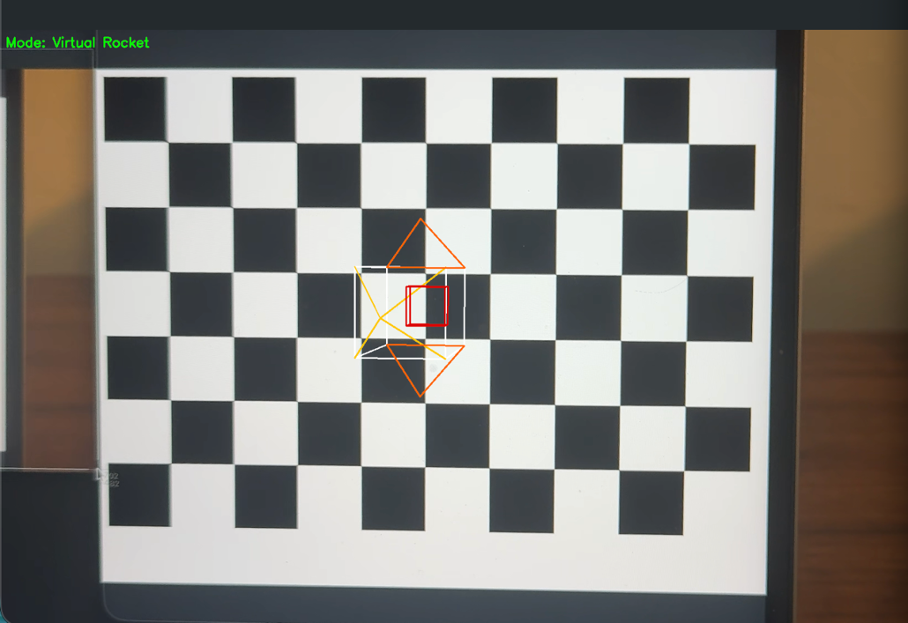
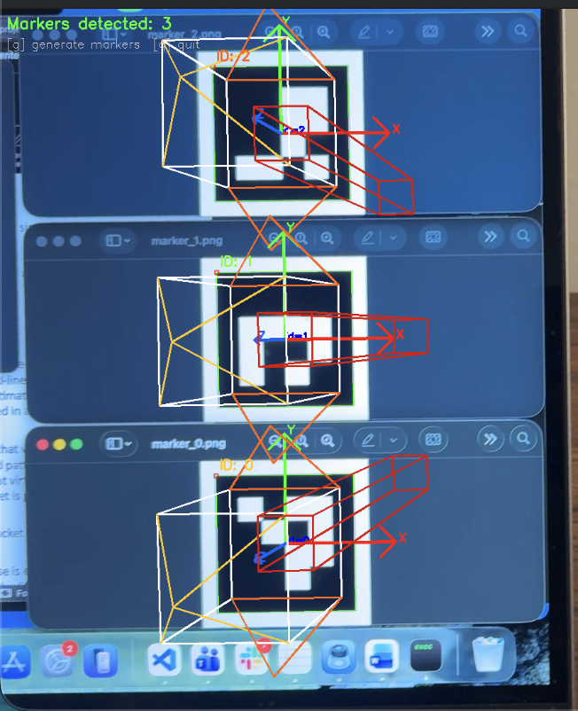
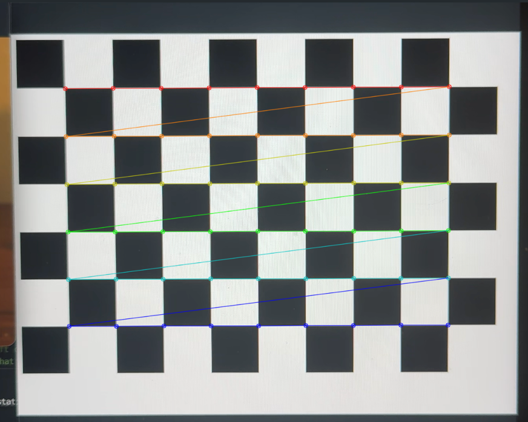
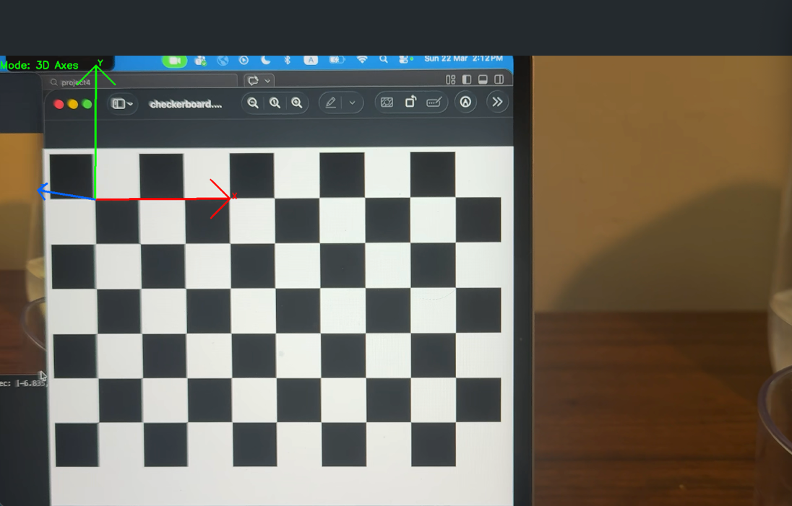
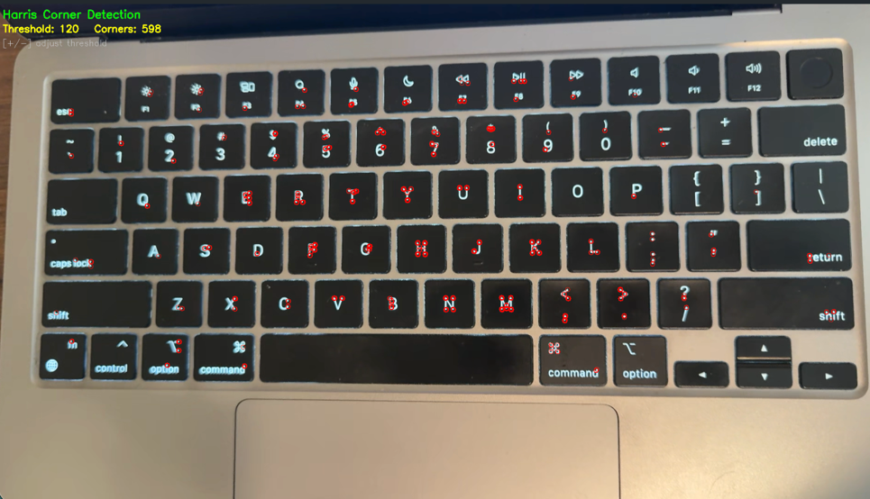
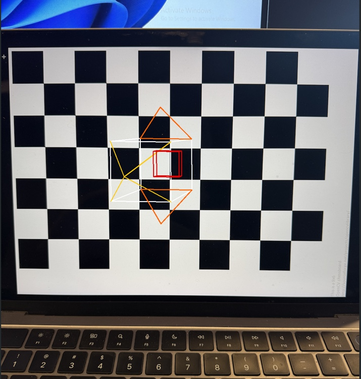

# Anchor

**Camera calibration and augmented reality in C++ with OpenCV.**

Anchor calibrates a webcam from a checkerboard target, estimates the target's 3D pose in real time, and projects virtual 3D objects onto the scene so they stay anchored to the target as the camera moves. It also supports multiple ArUco targets, AR on still photos, and Harris corner feature detection.

<p align="center">
  
  
</p>

## Features

| Program | What it does |
|---|---|
| `calibration` | Detects the 9×6 checkerboard live, collects calibration frames, runs `calibrateCamera`, and saves intrinsics + distortion to `intrinsics.yml` |
| `augmentedReality` | Estimates board pose with `solvePnP` each frame and renders either 3D axes or a wireframe rocket |
| `multiTarget` | Detects multiple ArUco markers (`DICT_4X4_50`) and renders an independently posed rocket on each |
| `staticAR` | Inserts the virtual rocket into a pre-captured photo of the checkerboard |
| `harris` | Live Harris corner detection with an adjustable response threshold |

## How it works

1. **Corner detection.** `findChessboardCorners` locates the 54 internal corners, and `cornerSubPix` refines them to sub-pixel accuracy.
2. **Calibration.** Each saved frame pairs its 2D corners with 3D world points `(col, -row, 0)`, where one board square equals one unit. `calibrateCamera` with `CALIB_FIX_ASPECT_RATIO` then estimates the camera matrix and distortion coefficients. The example calibration reaches a 0.25 px RMS reprojection error.
3. **Pose estimation.** `solvePnP` recovers the board's rotation and translation relative to the camera on every frame.
4. **Rendering.** Virtual geometry is defined in world coordinates and projected with `projectPoints`. The rocket is made of a prism body, nose cone, asymmetric fins and an exhaust nozzle. The asymmetry makes the orientation easy to verify.

<p align="center">
  
  
  
</p>

## Build

Requirements: a C++17 compiler, OpenCV 4.7 or newer (for the `cv::aruco::ArucoDetector` API), and `pkg-config`.

```bash
# macOS
brew install opencv pkg-config
# Ubuntu / Debian
sudo apt install libopencv-dev pkg-config

make            # builds all programs into bin/
make clean
```

## Usage

Run the programs from the repository root. They read and write `intrinsics.yml` in the current directory.

**1. Print or display the target.** Use [`assets/checkerboard.png`](assets/checkerboard.png) (9×6 internal corners). Keep the whole board in view with a white border around it.

**2. Calibrate your camera.**
```bash
./bin/calibration
```
| Key | Action |
|---|---|
| `s` | Save the current frame's corners (from varied angles and distances) |
| `c` | Calibrate (needs at least 5 saved frames) |
| `w` | Write `intrinsics.yml` |
| `q` | Quit |

Intrinsics are specific to each camera. [`assets/intrinsics_example.yml`](assets/intrinsics_example.yml) is a sample from a 1920×1080 webcam and is included for reference only.

**3. Run AR.**
```bash
./bin/augmentedReality      # 2 = axes, 3 = rocket, q = quit
./bin/multiTarget           # g = generate markers, q = quit
./bin/staticAR photo.png    # s = save output, q = quit
./bin/harris                # +/- = adjust threshold, q = quit
```

For `multiTarget`, display or print the markers in [`assets/markers/`](assets/markers) at the same size. For `staticAR`, the photo must come from the same camera you calibrated and show the full checkerboard.

<p align="center">
  
</p>

## Project structure

```
├── makefile
├── include/virtualObject.h   # rendering API
├── src/
│   ├── calibration.cpp
│   ├── augmentedReality.cpp
│   ├── multiTarget.cpp
│   ├── staticAR.cpp
│   ├── harris.cpp
│   └── virtualObject.cpp     # axes + wireframe rocket
├── assets/                   # checkerboard, ArUco markers, example intrinsics
└── docs/images/              # screenshots
```

## Author

Furqan Abid
